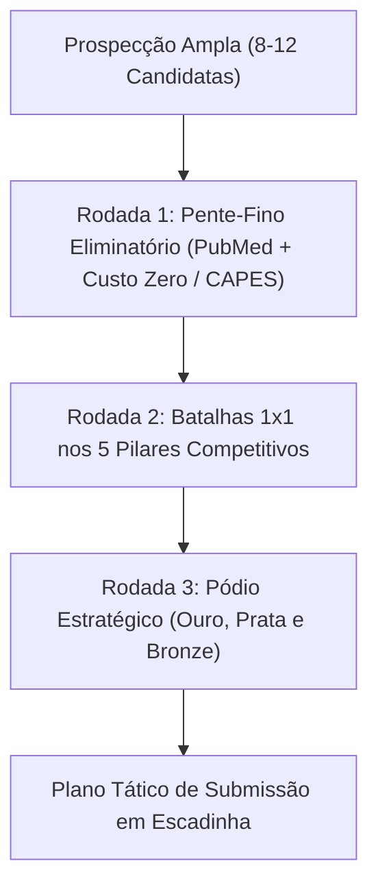

# Journal Selection Tournament (Torneio de Revistas Científicas)

Esta skill executa uma avaliação competitiva, estruturada em torneio multicritério, para selecionar e ranquear os melhores periódicos científicos para a submissão de um artigo ou revisão sistemática/meta-análise.

## 1. Filtros Eliminatórios Inegociáveis (Hard Constraints)

Nenhum periódico pode entrar na fase de grupos ou no pódio do torneio sem cumprir simultaneamente dois requisitos mandatórios:

1. **Indexação Obrigatória no PubMed / MEDLINE:**
   - O periódico deve estar obrigatoriamente listado no **NLM Catalog** com status de indexação ativo no PubMed e MEDLINE (`Currently indexed for MEDLINE: Yes`).
   - Periódicos sem indexação no PubMed são desclassificados sumariamente na Rodada 1.

2. **Custo ZERO de Publicação para os Autores (Zero APC Guarantee):**
   - **Opção A — Acordo Transformativo CAPES (Transformative Agreement):**
     - Periódicos pertencentes a grandes editoras com acordos vigentes com a CAPES / Portal de Periódicos (ex: **Elsevier**, **Springer Nature**, **Wiley**, **Oxford University Press**, **Taylor & Francis**, **Cambridge University Press**, **American Chemical Society**).
     - Garante isenção de 100% da Taxa de Processamento de Artigo (APC) para autores correspondentes afiliados a instituições consorciadas (ex: USP, UNESP, UNICAMP, UNIFESP, universidades federais e estaduais participantes).
   - **Opção B — Publicação Gratuita (Diamond Open Access / No-APC):**
     - Revistas operadas por sociedades médicas, universidades públicas ou consórcios acadêmicos onde autores e leitores não pagam nenhuma taxa de submissão ou publicação (ex: revistas SciELO Diamond).
   - **Opção C — Modelo Híbrido com Opção de Assinatura Tradicional (Subscription / Green OA com APC Zero):**
     - Periódicos que oferecem a via tradicional de publicação sem custos de autoria, onde a biblioteca/leitor paga pelo acesso e os autores não arcam com APC.
   - **Regra de Ouro:** Revistas Gold Open Access que cobrem APC mandatória sem isenção ou acordo ativo com a CAPES são terminantemente proibidas no torneio.

---

## 2. As 3 Rodadas do Torneio de Revistas

### Rodada 1: Pente-Fino Eliminatório
- Verificação do ISSN no NLM Catalog / PubMed.
- Verificação da editora na planilha oficial de Acordos Transformativos CAPES / Portal de Periódicos.
- Descarte imediato de periódicos predatórios, sem PubMed ou com APC não subsidiada.

### Rodada 2: Confrontos Diretos nos 5 Pilares Competitivos (Score 0 a 10)
Cada candidata qualificada é pontuada em 5 pilares estratégicos:

1. **Pilar 1: Impacto e Prestígio Científico (Peso 2.5):**
   - Journal Impact Factor (JIF 2024/2025, Clarivate Web of Science).
   - Classificação Qualis CAPES (A1, A2, A3).
   - Prestígio e respeitabilidade entre bancas de concurso, livre-docência e titulação acadêmica.
2. **Pilar 2: Alinhamento Temático e Leitor-Alvo (Peso 2.5):**
   - Afinidade do escopo com a especialidade do trabalho (ex: Cirurgia Hepática, Transplante de Órgãos, Hepatologia Clínica).
   - Histórico de publicação recente de ensaios clínicos randomizados e revisões em rede no tema.
3. **Pilar 3: Velocidade Editorial e Previsibilidade (Peso 2.0):**
   - Tempo mediano até o primeiro parecer (*Time to first decision*).
   - Tempo até a aceitação final e publicação online.
   - Taxa de rejeição sem revisão (*Desk reject rate*).
4. **Pilar 4: Suporte à Arquitetura Editorial Complexa (Peso 1.5):**
   - Flexibilidade de limites de palavras (idealmente >3.500 a 4.500 palavras para meta-análises em rede).
   - Suporte a apêndices suplementares extensos (tabelas PRISMA 16b, códigos R, matrizes da liga).
   - Aceitação de figuras de alta complexidade (forest plots, gráficos de rede).
5. **Pilar 5: Segurança Contratual Financeira (Peso 1.5):**
   - Certeza de elegibilidade ao Acordo CAPES sem filas de espera ou limite de cotas esgotadas.
   - Clareza dos termos de autorização e ausência de taxas ocultas de páginas coloridas ou tabelas extras.

### Rodada 3: Pódio Final e Roteamento Tático (Estratégia em Escadinha)
O torneio resulta na escolha formal de 3 periódicos dispostos em hierarquia tática:

1. **Alvo A — Medalha de Ouro (Moonshot de Alto Impacto):**
   - O melhor periódico do mundo na área onde o trabalho tem chances reais de aceitação.
   - Submissão com toda a força analítica, manuscrito polido e apêndice completo.
2. **Alvo B — Medalha de Prata (Padrão-Ouro / Sweet Spot Especializado):**
   - A melhor revista especializada do nicho cirúrgico/clínico (Qualis A1/A2), com alto índice de citação por pares da especialidade e velocidade editorial ágil.
3. **Alvo C — Medalha de Bronze (Rede de Segurança / Defesa Rápida):**
   - Periódico indexado no PubMed com aceitação previsível e tramitação rápida, garantindo que o trabalho seja publicado sem custos caso os alvos anteriores exijam tempo excessivo.

---

## 3. Matriz de Integração com a Article Machine

Ao concluir o torneio, a skill deve:
1. Gerar o relatório analítico do torneio em `evidence/relatorio_torneio_de_revistas.md` e espelhar em `publicacoes/<project_dir>/08_revisao/portugues/` e `ingles/`.
2. Preparar a estrutura das 9 pastas com o slug do periódico vencedor através de `article-machine publish prepare <dir> --journal <slug>`.
3. Atualizar o manifesto editorial da publicação com os requisitos de formatação (limite de palavras, estilo de referências, número máximo de figuras/tabelas) do Alvo A vencedor.
